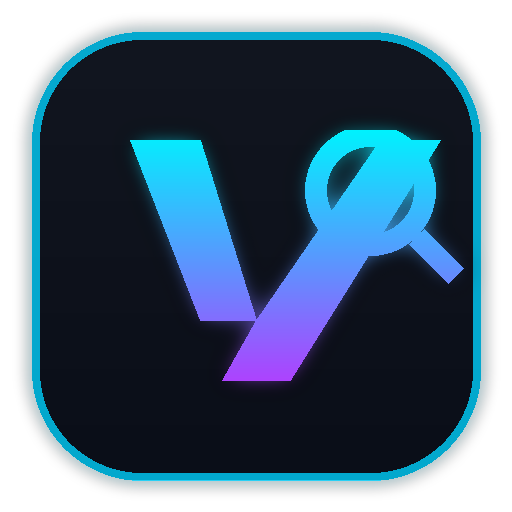

<p align="center">
  
</p>

<h1 align="center">⚡ VibeRun</h1>

<p align="center">
  <b>Ultra-lightweight, blazing-fast Windows Quick Launcher & Search Tool</b><br/>
  <i>Giải pháp thay thế siêu nhẹ, tiết kiệm RAM cho PowerToys Run trên Windows 10 & 11</i>
</p>

<p align="center">
  
  
  
  
</p>

---

## 📌 1. Tên dự án & Mục tiêu chính (Project Overview)

- **Tên dự án:** **VibeRun** (Lightweight Windows Quick Launcher)
- **Mục tiêu:** Mang lại trải nghiệm tìm kiếm và khởi chạy ứng dụng nhanh như **PowerToys Run** hoặc **Mac Spotlight**, nhưng loại bỏ hoàn toàn 20+ module thừa của PowerToys để tối ưu mức tiêu thụ RAM và CPU xuống mức tối thiểu.

### 📊 Bảng so sánh hiệu năng thực tế

| Tiêu chí | Microsoft PowerToys Run | ⚡ **VibeRun** |
| :--- | :--- | :--- |
| **Mức ăn RAM chạy ngầm** | ~150MB – 350MB+ (chạy .NET WinUI 3 + nhiều service) | **~20MB – 25MB** (tự động giải phóng Working Set khi ẩn) |
| **Tải CPU khi idle** | ~0.5% – 2.0% | **0.0%** (Win32 message loop tĩnh) |
| **Thời gian phản hồi tìm file**| ~50ms – 250ms | **1ms – 5ms** (Truy vấn trực tiếp Windows Search OLE DB) |
| **Công cụ dư thừa đi kèm** | Kèm >20 tiện ích (Awake, Hosts, OCR, ColorPicker...) | **100% tinh gọn, chỉ làm launcher** |
| **Tự động focus con trỏ vào ô nhập**| ❌ Phải click thủ công |  **Tự động đưa con trỏ văn bản (caret) vào ô nhập sẵn sàng gõ (giữ nguyên vị trí con chuột)** |
| **Click ra ngoài tự đóng** | ⚠️ Đôi khi bị kẹt focus |  **Nhấp bất kỳ đâu ngoài cửa sổ là đóng tức thì** |

---

## ✨ 2. Các tính năng nổi bật (Key Features)

- ⌨️ **Phím tắt toàn cục (`Alt + Space`):** Bật/tắt thanh tìm kiếm nổi ngay tức thì từ bất kỳ đâu.
- 🎯 **Tự động Focus con trỏ nhập liệu:** Ngay khi mở (`Alt + Space`), con trỏ văn bản (caret) sẽ lập tức nằm trong thanh tìm kiếm để bạn gõ ngay mà không phải click chuột, đồng thời vị trí con chuột vật lý trên màn hình hoàn toàn được giữ nguyên.
- 🖱️ **Click-outside Auto Close:** Nhấp chuột ra bất kỳ vị trí nào bên ngoài cửa sổ (Desktop, thanh tác vụ, cửa sổ khác) sẽ tự động ẩn ngay lập tức.
- 🚀 **Tìm kiếm ứng dụng toàn diện (`APP`):**
  - Tự động nhận diện cả ứng dụng Win32 truyền thống (`.exe`, `.lnk` Start Menu) lẫn ứng dụng Store/UWP hiện đại (Zalo, ChatGPT, Telegram, Steam, NVIDIA App, Settings...).
- ⚙️ **Cài đặt & Lệnh hệ thống (`SETTINGS`, `TOOL`, `SYSTEM`):**
  - Tra cứu nhanh hơn 100+ trang cài đặt Windows (`ms-settings:` Display, Sound, Wi-Fi, Bluetooth, Windows Update, v.v.).
  - Hỗ trợ từ khóa cả **Tiếng Anh lẫn Tiếng Việt không dấu/có dấu** (ví dụ: `khoa may`, `tat may`, `man hinh`, `am thanh`, `thung rac`...).
  - Các thao tác nhanh: *Khóa màn hình, Sleep, Khởi động lại, Tắt máy, Dọn thùng rác, Task Manager, Device Manager, Command Prompt, PowerShell, Registry Editor*.
- 📁 **Tìm kiếm tệp & thư mục siêu tốc (`FILE`, `FOLDER`):**
  - Tích hợp trực tiếp với Windows Search Indexer OLE DB (`CollatorDSO`), tìm kiếm tức thì trên toàn ổ đĩa chỉ trong vài mili-giây mà không làm đơ máy.
  - Hỗ trợ gõ trực tiếp đường dẫn thư mục (vd: `C:\` hoặc `D:\VibeCode`) để duyệt nhanh.
- 🧮 **Máy tính nhanh (`CALC`):**
  - Tự động phát hiện và tính toán các phép toán số học, lũy thừa, lượng giác ngay trên thanh tìm kiếm (vd: `1024 / 8`, `sqrt(144)`, `2^10`, `15% of 200`). Nhấn `Enter` để sao chép kết quả vào Clipboard.
- 🖼️ **Giao diện hiện đại & Khay hệ thống:**
  - Giao diện Fluent Dark Mode, bo tròn góc theo phong cách Windows 11.
  - Icon chữ V neon nổi bật hiển thị ở khay hệ thống (System Tray) kèm menu chuột phải tiện lợi.

---

## 📂 3. Cấu trúc thư mục dự án

```
D:\VibeCode\VibeRun/
├── README.md                 # Tài liệu tổng quan dự án
├── requirements.txt          # Các thư viện phụ thuộc (pywin32, pillow)
├── config.json               # Cấu hình phím tắt, giao diện, bộ lọc
├── run.bat                   # Khởi chạy có cửa sổ console (debug/log)
├── start_silent.bat          # Khởi chạy ngầm hoàn toàn không hiện cmd
├── add_to_startup.bat        # Bật tự khởi động cùng máy tính
├── remove_from_startup.bat   # Tắt tự khởi động cùng máy tính
├── assets/
│   ├── logo.png              # Logo phân giải cao (512x512)
│   ├── logo_28.png           # Logo thanh tìm kiếm (28x28)
│   └── logo.ico              # Icon đa kích thước cho khay hệ thống
├── scripts/
│   └── generate_logo.py      # Script tự sinh logo đồ họa
├── src/
│   ├── config.py             # Quản lý cài đặt & phím tắt
│   ├── core/
│   │   ├── app_indexer.py    # Quét ứng dụng Win32/UWP
│   │   ├── file_search.py    # Tìm kiếm file qua Windows Search OLE DB
│   │   ├── system_tools.py   # Bảng tra cứu Settings & System Commands
│   │   ├── calculator.py     # Bộ xử lý phép tính an toàn
│   │   └── search_engine.py  # Thuật toán xếp hạng và điều phối kết quả
│   ├── platform/
│   │   ├── hotkey.py         # Đăng ký phím tắt Win32 toàn cục
│   │   └── memory.py         # Win32 API giải phóng Working Set RAM
│   └── ui/
│       ├── launcher_window.py# Giao diện Floating Bar, auto-focus & click-outside
│       └── tray_icon.py      # Icon điều khiển khay hệ thống
└── tests/
    ├── test_calc.py          # Kiểm thử máy tính nhanh
    ├── test_indexer.py       # Kiểm thử quét ứng dụng
    ├── test_search.py        # Kiểm thử bộ máy tìm kiếm
    └── test_mem_footprint.py # Kiểm thử đo đạc RAM tiêu thụ
```

---

## 🚀 4. Hướng dẫn cài đặt & Khởi chạy (Installation & Usage)

### Yêu cầu hệ thống:
- Hệ điều hành: **Windows 10 / Windows 11 (64-bit)**
- **Python 3.10 trở lên**

### Cài đặt:
```bash
# Clone repository về máy
git clone https://github.com/lvh0210/VibeRun.git
cd VibeRun

# Cài đặt thư viện phụ thuộc tối thiểu
pip install -r requirements.txt
```

### Khởi chạy:
- **Cách 1 (Chạy ngầm chuyên nghiệp):** Click đúp vào file `start_silent.bat`. Ứng dụng sẽ chạy ngầm hoàn toàn, xuất hiện biểu tượng ở khay hệ thống (góc dưới bên phải màn hình).
- **Cách 2 (Chạy có log console):** Click đúp vào file `run.bat`.
- **Tự khởi động cùng Windows:** Click đúp vào file `add_to_startup.bat`. Để gỡ bỏ, click `remove_from_startup.bat`.

---

## 🎮 5. Phím tắt & Thao tác (Shortcuts)

| Thao tác | Phím tắt |
| :--- | :--- |
| **Bật / Tắt VibeRun** | `Alt + Space` |
| **Điều hướng kết quả** | `Mũi tên Xuống` / `Mũi tên Lên` |
| **Chọn & Khởi chạy** | `Enter` (hoặc Click chuột trực tiếp) |
| **Ẩn cửa sổ** | `Esc` (hoặc Click ra ngoài cửa sổ) |

---

## ⚙️ 6. Tuỳ biến cấu hình (`config.json`)

Bạn có thể chỉnh sửa file `config.json` để thay đổi phím tắt hoặc giao diện:

```json
{
    "hotkey": "alt+space",
    "max_results": 8,
    "file_search_limit": 5,
    "theme": {
        "bg_color": "#1e1e1e",
        "card_bg": "#252526",
        "card_selected": "#094771",
        "text_primary": "#ffffff",
        "accent_color": "#007acc"
    },
    "features": {
        "calculator": true,
        "apps": true,
        "system_tools": true,
        "files": true
    }
}
```

---

## 📄 7. Giấy phép (License)

Dự án được phát hành theo giấy phép **[MIT License](LICENSE)**. Tự do sử dụng, chỉnh sửa và đóng góp!
